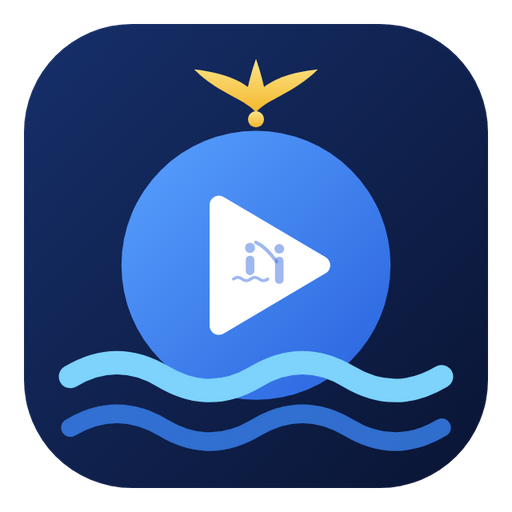
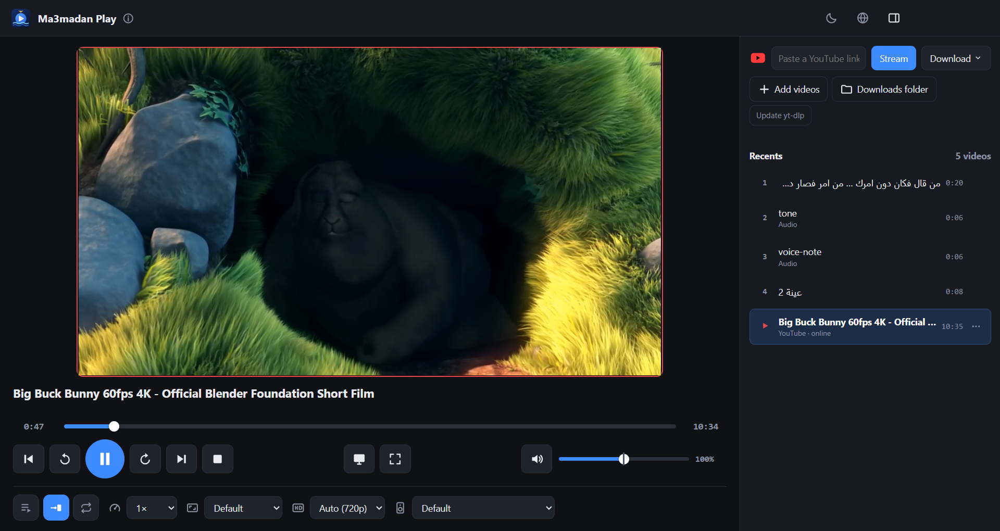

<p align="center">
  
</p>

<h1 align="center">Ma3madan Play</h1>

<p align="center">
  <b>The audience sees the video. You see everything else.</b><br>
  A video player for Windows, built for presenting on a second screen.
</p>

<p align="center">
  <a href="https://github.com/michaelsaad/ma3madan-video-presenter/releases/latest"><b>⬇ Download for Windows</b></a>
</p>



## Why this app?

Playing a video for an audience usually goes like this:

- 🖱️ You drag a player window onto the projector and everyone watches your mouse hunt for the full-screen button.
- ⏸️ You pause, and a giant pause icon and progress bar sit on the big screen.
- 🔊 You turn the volume up, and a volume overlay pops up for everyone.
- 📺 You play from YouTube, and the room gets the title bar, the controls, an ad, and a wall of suggested videos when it ends.
- ⏳ You download first, then hunt for the file in a folder… on the projector.

**Ma3madan Play splits the job across two screens.** The projector is the stage: it only ever shows the video, or a clean black screen. Your laptop is backstage. Everything else stays on your laptop: the list of recent videos, the controls, the volume, YouTube links, and a live preview of exactly what the audience sees. Pause, seek, boost the volume, line up the next clip, swap a YouTube link: none of it ever reaches the big screen.

What the audience gets is a smooth, distraction-free flow from one video to the next, the way a professional production feels.

It plays your own video files and YouTube links, streamed directly or downloaded first. Either way, YouTube's page, ads and suggestions never reach the projector. And when there's no projector, it's simply a clean everyday video player.

*Ma3madan* (المعمدان) means "the Baptist". The app was originally made for **St. John the Baptist Church in Qalyub, Al-Qalyubia, Egypt**. It's free for anyone to use, for anything.

## Features

- **Presenter mode (two screens).** The projector shows a clean, full-screen video: no controls, no pop-ups, and the mouse only shows while you move it there. Your laptop shows the controls and a live preview of the projector.
- **Player mode (one screen).** The video plays inside the window like a normal player. Full screen with `F` or a double-click, `Esc` to leave. The app picks the mode by itself: Presenter when a second screen is connected, Player when there isn't one or when you open a video from Explorer. The **Player / Presenter** button switches any time.
- **Local files.** MP4, MKV, WebM and MOV video. Drag files in or use **Add videos**.
- **Audio too.** MP3, WAV, M4A/AAC, FLAC, and WhatsApp voice notes (`.opus`/`.ogg`). Audio plays with sound only: the projector stays black.
- **Vocal remover (karaoke).** Split any song or video into music and vocals, then mix them live while it plays: karaoke, vocals only, or anything in between. Save any mix as an MP3.
- **YouTube.**
  - **Stream** plays a link right away without downloading it. Quality drops automatically when the internet is slow, like on YouTube.
  - **Download** saves the video to your PC as a single MP4 (up to 1080p) so it plays offline, or just the sound as an **MP3**.
  - Streamed something and want to keep it? Use the item's **⋯** menu (or right-click) → **Download video** or **Download as MP3**. The same menu opens the file's folder or the YouTube link.
- **Black screen** (`B`) fades the projector to black at any moment.
- **Volume up to 200%**, like VLC, for quiet videos in a big hall.
- **Aspect ratio** (`A`): 16:9, 4:3, 2.35:1, stretch, zoom and more.
- **Recents**: your videos stay listed between sessions, with auto-play next, loop, speed control and black-at-end.
- **Audio output picker** to send the sound to the projector's HDMI or to the hall's speakers.
- **English and Arabic** interface (Arabic is right-to-left).
- **Light and dark themes** that follow Windows, or pick one with the sun/moon button.
- **A flexible window.** Resize it or snap it to half the screen. Drag the side panel's edge to make it wider or narrower, or hide it with `Ctrl + B`.
- **Opens videos from Explorer** and can be set as the default video player.

## Install

1. Download **`Ma3madan-Play-Setup-x.y.z.exe`** from the [latest release](https://github.com/michaelsaad/ma3madan-video-presenter/releases/latest).
2. Run it. Because the app is new and not code-signed yet, Edge or Windows may warn you first. See [Windows says the file is unsafe](#windows-says-the-file-is-unsafe) below.
3. Pick where to install it. No admin rights are needed. You'll get a desktop shortcut and a Start-menu entry.

Prefer not to install? Download **`Ma3madan-Play-Portable-x.y.z.exe`** and run it from anywhere, even a USB stick. The portable version can't register itself as a video player.

Requirements: Windows 10 or 11 (64-bit). The installer is about 75 MB and there's nothing else to install. The first time you use a YouTube link, the app sets up [yt-dlp](https://github.com/yt-dlp/yt-dlp) by itself: about 17 MB, downloaded from its official GitHub release and checked against its published SHA-256 checksum. The first download sets up [FFmpeg](https://ffmpeg.org/) the same way (about 28 MB, a pinned build checked against a fixed SHA-256).

### Windows says the file is unsafe

Edge and Windows SmartScreen warn about any new program that isn't code-signed and hasn't been downloaded by many people yet. The warning is about reputation, not about anything found in the file. All the source code is in this repository, and every release is built from it.

- **Edge** ("isn't commonly downloaded" / "could harm your device"): open Downloads (`Ctrl + J`), hover over the file, click **⋯** → **Keep** → **Show more** → **Keep anyway**.
- **Windows SmartScreen** ("Windows protected your PC"): click **More info** → **Run anyway**.

The warnings fade as more people download the app. Signed releases (see [Code signing policy](#code-signing-policy)) build that trust faster and show a verified publisher.

### Updates

The app used to be called *Ma3madan Video Presenter*. Updating keeps your settings, videos and downloads.

When a new version is out, an **Update to x.y.z** button appears in the top bar. Nothing changes until you click it, so it never interrupts a presentation. The app downloads the new installer, checks it against the SHA-256 that GitHub publishes for the file, installs it and restarts. The portable version's button opens the download page instead.

## Using it with a projector

1. Connect the projector and press **`Win + P`**, then choose **Extend**. Don't choose Duplicate.
2. Open the app. It switches to Presenter mode and puts the video on the second screen by itself. If you have more than one extra screen, pick the right one under **Output screen**, in the **Screen** section at the bottom of the side panel.
3. Optional: under **Audio output**, choose where the sound should come out (for example the projector's HDMI).
4. Double-click a video in **Recents** to play it on the projector.

With only one screen (for example, rehearsing on a laptop), the app works in Player mode: the video plays inside the window, and **Full screen** (or `F`, or a double-click) fills the screen.

## YouTube: Stream or Download?

| | Stream | Download |
|---|---|---|
| Starts | in a few seconds | after the download finishes |
| Needs internet while playing | yes | no |
| Quality | adapts to your connection (starts at 720p) | up to 1080p |
| Best for | a good, steady connection | anything important, or weak Wi-Fi |

Downloads are saved to `Videos\Ma3madan Play` as one ordinary `.mp4` file each, so they play in any other player too.

You can change a stream's quality from the **Quality** menu while it plays. **Auto** lowers it on its own when the connection can't keep up.

If YouTube links stop working one day, click **Update yt-dlp**. YouTube changes things from time to time and yt-dlp keeps up with them. Live streams aren't supported.

## Vocal remover

Open a video's or song's **⋯** menu (or right-click it) → **Remove vocals (karaoke)**. The sound is split once into two tracks, music and vocals, saved under `Videos\Ma3madan Play\Separated`. From then on, that item plays with a **mixer**:

- **Vocals** and **Music** sliders, 0–100%, that you can move live while it plays
- Presets: **Karaoke** (music only), **Original**, **Vocals only**
- **Save as MP3** saves exactly what the sliders are set to, for example vocals at 50% with the music at 100%

The same menu turns karaoke on or off for that item and saves a mix without playing it.

There are two ways to do the separation (choose under **Vocal remover settings…**):

| | Online (recommended) | On this PC |
|---|---|---|
| Works on | any PC, even old ones: your PC does nothing | best with a graphics card |
| Quality | best (BS Roformer model) | very good (MDX-Net model) |
| Needs | a free [MVSEP](https://mvsep.com) account and its [API key](https://mvsep.com/user-api) | about 95 MB downloaded the first time |
| Time for a 4-minute song | usually a few minutes, depending on MVSEP's queue | ~30 s with a graphics card, a few minutes on a laptop CPU |

Online, the song's sound is uploaded to MVSEP, separated on their servers, downloaded back, and deleted from their server. On this PC, nothing leaves your computer. The app picks the fastest graphics card by itself.

## Keyboard shortcuts

| Key | Action |
|---|---|
| `Space` / `K` | Play / pause |
| `←` `→` | Back / forward 5 s (`Shift` = 30 s) |
| `J` `L` | Back / forward 10 s |
| `↑` `↓` | Volume (up to 200%) |
| `M` | Mute |
| `B` | Black screen |
| `N` / `P` | Next / previous video |
| `A` | Cycle aspect ratio |
| `0`–`9` | Jump to 0%–90% |
| `Home` / `End` | Start / end |
| `Enter` | Play the selected video |
| `Shift` + `↑` `↓` | Move the selection in Recents |
| `Delete` | Remove the selected video from the list |
| `F` / double-click | Full screen (Player mode) |
| `Esc` | Leave full screen |
| `Ctrl + B` | Show or hide the side panel |
| `Ctrl + O` | Add videos |

Shortcuts also work while the video has focus.

## Make it your default video player

After installing, either:

- **Settings → Apps → Default apps → Ma3madan Play**, then choose it for `.mp4`, `.mkv` and the other types, or
- right-click a video → **Open with → Choose another app** → **Ma3madan Play**, and tick **Always**.

Windows doesn't let apps make themselves the default; you have to choose it once yourself.

## Build from source

You'll need [Node.js](https://nodejs.org) 20 or newer.

```bash
git clone https://github.com/michaelsaad/ma3madan-video-presenter.git
cd ma3madan-video-presenter
npm install
npm start             # run the app
npm run dist          # build the installer and the portable .exe into dist/
```

Other scripts:

- `npm test` runs an end-to-end self-test. It plays sample clips, checks controls, volume boost and aspect ratio, and saves screenshots. Set `VP_STREAM=<youtube url>` to also test streaming, including a simulated slow connection, or `VP_YT=<url>` to test downloading.
- `npm run icon` re-renders the app icon from `build/icon.svg`.

### How it works

| File | Role |
|---|---|
| `src/main.js` | Electron main process: windows, screens, Player/Presenter modes, theme, settings, Recents, IPC |
| `src/control.html` · `control.js` · `control.css` | The operator window |
| `src/output.html` | The video engine (on the projector in Presenter mode, inside the main window in Player mode): playback, Web Audio volume boost, aspect ratio, stream buffering and automatic quality |
| `src/youtube.js` | yt-dlp: downloads, and resolving stream formats into a quality ladder |
| `src/stream-proxy.js` | Local proxy that fetches YouTube streams in chunks, so they aren't throttled to playback speed |
| `src/i18n.js` | English and Arabic strings |
| `build/installer.nsh` | Registers the app under Windows Default apps |

In Presenter mode, the preview in the control window is a live capture of the projector, so it always shows exactly what the audience sees. In Player mode, the same video engine is moved into the main window over the preview box, so switching modes never interrupts playback.

### Releasing

Releases are built by GitHub Actions ([`.github/workflows/release.yml`](.github/workflows/release.yml)):

1. Bump `version` in `package.json` and commit.
2. Push a matching tag: `git tag v1.2.0 && git push origin v1.2.0`.
3. The workflow builds the installer and the portable `.exe`, signs them when signing is set up, and creates a **draft** release with both files. Check it, edit the notes, and publish.

## Code signing policy

Free code signing provided by [SignPath.io](https://about.signpath.io), certificate by [SignPath Foundation](https://signpath.org).

- Committers and reviewers: [Michael Saad](https://github.com/michaelsaad)
- Approvers: [Michael Saad](https://github.com/michaelsaad)

Only files built by this repository's GitHub Actions workflow from its public source code are signed. Each signing request is approved by hand.

**Privacy:** the app doesn't collect, store or send any personal data or usage statistics. It connects to the internet only when you ask it to: YouTube when you stream or download a link; GitHub to set up or update its tools (yt-dlp, FFmpeg, the vocal remover) and to check for app updates; and MVSEP only if you choose the online vocal remover, which uploads that song's sound for separation. Settings and the list of recent videos stay on your computer.

## Third-party software

- [Electron](https://www.electronjs.org/) (MIT), bundled
- [yt-dlp](https://github.com/yt-dlp/yt-dlp) (Unlicense), downloaded from its official release on first YouTube use
- [FFmpeg](https://ffmpeg.org/) (GPL), the [ffmpeg-static](https://github.com/eugeneware/ffmpeg-static) b6.1.1 build, downloaded for MP3 conversion and the vocal remover. Its source is available from ffmpeg.org.
- [ONNX Runtime](https://onnxruntime.ai/) 1.22 (MIT) with DirectML, downloaded for the on-PC vocal remover
- The UVR-MDX-NET Inst HQ 3 model from [Ultimate Vocal Remover](https://github.com/Anjok07/ultimatevocalremovergui), downloaded from its official model repository
- [MVSEP](https://mvsep.com), an online service used only if you choose it, under its own terms

Only use YouTube content you have the right to show, and follow YouTube's Terms of Service.

## License

Free to use for any person or organization, for any purpose: use it, copy it, change it and share it ([MIT License](LICENSE)).

The app is provided as is, without warranty of any kind, and may contain bugs. Please try it before relying on it at an important event. If you find a problem, [open an issue](https://github.com/michaelsaad/ma3madan-video-presenter/issues).

---

<p align="center">Developed by Michael Saad · © 2026</p>
